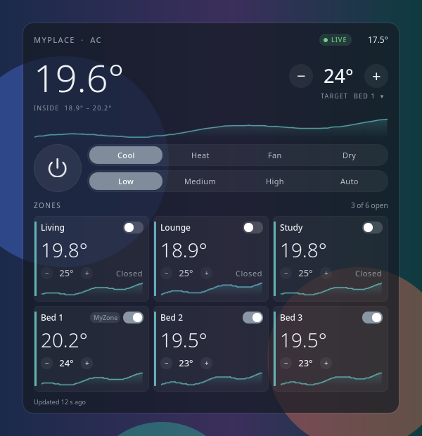
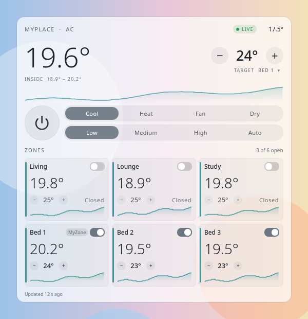
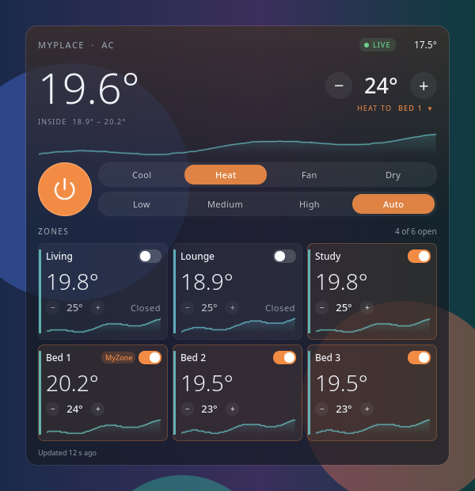

# Climate Deck

A Plasma 6 desktop widget that monitors and controls an Advantage Air **MyPlace** / MyAir ducted air conditioner. It talks straight to the wall touch screen over your local network, with no cloud account, no polling of Advantage Air's servers and no helper process.

[](https://github.com/xiahongze/climate-deck/actions/workflows/ci.yml)  

| Dark | Light |
| --- | --- |
|  |  |

While the unit runs, the deck takes on the mode's colour:



## What it shows

- **Header.** Site and aircon name, link status (`LIVE`, `RETRYING`, `OFFLINE`) and the outdoor temperature when the tablet has a valid reading.
- **Inside.** The average of every zone with a working sensor, the coldest-to-warmest range, and a trace of the last few hours.
- **Target and MyZone.** The set point, with − and +. When a MyZone is set, this is the MyZone zone's target, matching the MyPlace app. Click the zone name under the target (`BED 1 ▾`) to pick a different MyZone, the zone the system optimises for. Only zones with a working sensor are listed; choosing a closed zone opens it, as the app does.
- **Power, mode and fan.** Cool, Heat, Fan, Dry, plus MyAuto if it is enabled on your system. Low, Medium, High and Auto. Auto is MyFan when the system supports it.
- **Zones.** Each zone shows:
  - its temperature, with a colour strip running from icy blue to warm red
  - an open/close switch
  - its own target, or a damper % for zones without a sensor (adjustable while closed too)
  - a MyZone badge where it applies
  - sensor warnings
  - a history sparkline
- **Footer.** How fresh the data is, unit error codes, the filter-clean reminder and on/off timers.

Changes show immediately. Taps on − and + are batched into one command, and the widget re-reads the tablet a moment later to confirm. If the tablet stops answering, the last reading stays on screen, dimmed, and the controls lock until it is back.

History is kept in memory: one sample a minute, four hours in total. It starts again when Plasma restarts.

## Requirements

- Plasma 6
- A MyPlace / MyAir / e-zone wall touch screen on the same network as the PC
- `kpackagetool6`
- Python 3, for packaging only

## Install

```sh
./scripts/install.sh
```

Then:
1. Right-click the desktop and choose **Add Widgets…**.
2. Add **Climate Deck**.
3. Open its settings and enter the tablet's IP address. **Test** checks it.

To find the tablet, look for an Android device in your router's client list, or scan for port 2025 (see [docs/API.md](docs/API.md#finding-the-tablet)). Give it a DHCP reservation so the address doesn't change.

If Plasma is already running an older copy, run `plasmashell --replace &` after upgrading so the new QML loads.

## Settings

- tablet address (port 2025 unless you give one)
- aircon (`ac1`–`ac4`, for multi-unit systems)
- refresh interval, 10 s by default
- theme: System, Light or Dark
- background opacity (0 shows the widget straight on the wallpaper)
- temperature history on or off

## How it works

The wall tablet runs an HTTP server on port 2025:
- `GET /getSystemData` returns the whole system as JSON.
- `GET /setAircon?json={"ac1":{…}}` changes it.

[docs/API.md](docs/API.md) documents the protocol, field by field. It was worked out from the decompiled MyPlace Android app and checked against a live system.

The code is split across three files:
- `contents/ui/myplace.js` holds the protocol helpers: URLs, parsing, clamping and MyZone targeting.
- `contents/ui/Client.qml` owns polling and commands. It sends one request at a time, aborts a request after 5 s, and keeps a pending overlay so a stale poll doesn't snap a control back.
- `contents/ui/DeckView.qml` draws the deck.

Nothing is sent anywhere except the tablet. The widget never adds query parameters to `getSystemData`; with a phone's `uid`, those would register a paired device.

## Develop and package

```sh
make test         # qmltestrunner, offscreen, against a fake tablet
make lint         # qmllint
make package      # dist/climate-deck.plasmoid
make install      # package, then install or upgrade with kpackagetool6
make screenshots  # re-render docs/screenshots from the redacted fixture
```

`tests/fixtures/system.json` is a real `getSystemData` reply with identifiers, push tokens, the PIN and the location replaced.

## Uninstall

```sh
kpackagetool6 --type Plasma/Applet --remove io.github.xiahongze.climatedeck
```

## Credits

Not affiliated with Advantage Air. MyPlace, MyAir and e-zone are their trademarks. Licensed under MIT.
